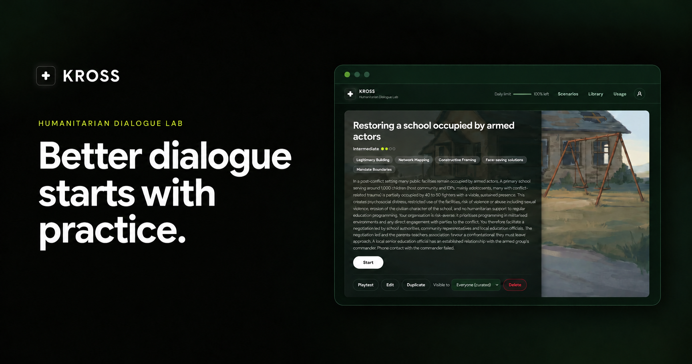
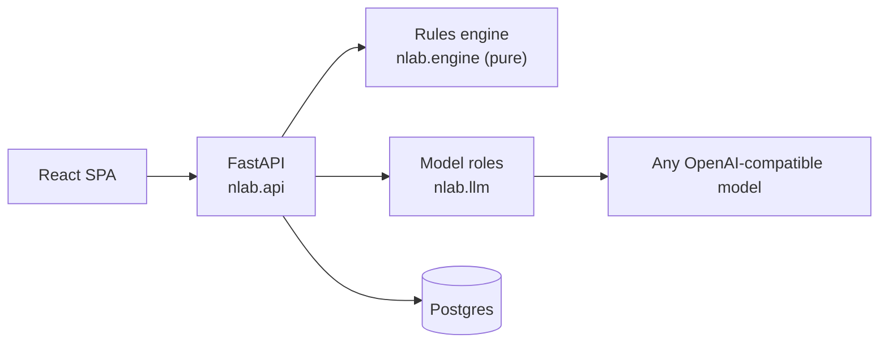

<div align="center">



# KROSS

**Humanitarian Dialogue Lab.** Practise difficult frontline negotiations before they happen.

[](https://github.com/alterminder/kross/actions/workflows/backend.yml)
[](https://github.com/alterminder/kross/actions/workflows/frontend.yml)
[](LICENSE)

[Try it](https://app.kross.im) · [Documentation](#documentation) · [Self-host](docs/deployment.md) · [Roadmap](ROADMAP.md)

</div>

---

KROSS is a negotiation simulator for humanitarian negotiators. A trainee talks to an AI counterpart (a checkpoint
commander, a camp authority, a police chief) and gets evidence-based feedback on every turn. Trainers build scenarios
from their own case briefs, watch and steer sessions live, and debrief with the trainee's own words.

It started at the ICRC challenge of the Swiss {ai} Weeks Geneva Hackathon (September 2026) and grew into a
multi-user app that organisations can host themselves.

## How it works

**The model only describes. Code decides.**

- A language model **labels** what the trainee said, and every label must quote the trainee's words, or it is dropped.
- A language model **plays** the counterpart.
- Plain, readable rules **move the hidden dials** (trust, rigidity, hostility), reveal hidden interests, fire twists
  and decide the outcome. Every change is logged with its reason.

So the simulation is controllable, measurable and explainable: a trainer can always see *why* the counterpart softened
or walked away.

## Features

| | |
| --- | --- |
| **Realistic practice** | A library of scenarios grounded in the CCHN method. The counterpart's reply streams in; hidden state stays hidden until the end |
| **Feedback with evidence** | Per-turn rubric scores with quotes. A debrief with the outcome, skill bars, what went well and what was missed (each with the trainee's words and a "try instead"), hidden facts found and missed, and an "Ask the Coach" chat |
| **Trainers see and steer** | Live dial sliders, preset and free-text twists (rewritten in character and bias-checked), rules fired, goal progress, a dials-over-time chart, turn review, comments, and the exact prompt the model was sent |
| **Authoring without engineers** | Turn a case brief into a scenario (quoted lines checked verbatim), or use the guided builder. A form editor with plain-language conditions, a YAML fallback, and playtest mode |
| **Knowledge library** | Notes on the 17 CCHN tools and wider negotiation practice, used by the coach and readable by trainees |
| **Organisations** | Sign-in with Google or your own SSO (OIDC), optional guest play, orgs with admin and member roles, invite links, an org library and per-org behaviour rules |
| **Cost control** | Per-user, per-org, guest and deployment-wide daily limits and a spend ceiling, checked before every model call |
| **Any model** | Any OpenAI-compatible endpoint, with a separate model per role if you want |

## Quick start

Run it locally with a scripted model (no API key needed). You need Docker, [uv](https://docs.astral.sh/uv/) and
Node 22.

```sh
git clone https://github.com/alterminder/kross.git && cd kross
docker compose -f compose.dev.yml up -d --wait db
(cd frontend && npm install && npm run build)
cd backend && uv sync && uv run python -m tests.dev_server
```

Then open <http://127.0.0.1:8765/api/auth/dev/login?as=alice> (`as=admin` gives you a superadmin). Add `--real-llm`
and an `LLM_API_KEY` in `backend/.env` to play against a real model. More in [docs/development.md](docs/development.md).

**Self-hosting** for real users is one app container plus Postgres behind Nginx: see
[docs/deployment.md](docs/deployment.md).

## Architecture



| Path | What |
| --- | --- |
| [`backend/`](backend/) | Python 3.12, FastAPI, SQLAlchemy, Alembic. `nlab.engine` (the pure rules), `nlab.llm` (model roles and prompts), `nlab.db` (Postgres), `nlab.api` (HTTP) |
| [`frontend/`](frontend/) | React, TypeScript, Vite |
| [`content/`](content/) | Curated scenarios, behaviour rules, the scoring rubric and knowledge notes |
| [`deploy/`](deploy/) | The database image and role setup used by `compose.yml`, and an Nginx example |

## Documentation

| Topic | |
| --- | --- |
| How it fits together | [Architecture overview](docs/architecture/README.md) · [Rules engine](docs/architecture/engine.md) · [Model layer](docs/architecture/llm.md) · [Backend](docs/architecture/backend.md) · [Frontend](docs/architecture/frontend.md) |
| Running and changing it | [Development](docs/development.md) · [Scenario authoring](content/scenarios/README.md) · [Knowledge notes](content/knowledge/README.md) |
| Operating it | [Configuration](docs/configuration.md) · [Self-hosting](docs/deployment.md) |
| Project | [Roadmap](ROADMAP.md) · [Contributing](CONTRIBUTING.md) · [Security](SECURITY.md) · [Code of conduct](CODE_OF_CONDUCT.md) |

## Status

KROSS is in active use, but every dial value, move effect and threshold is still a **draft** awaiting review by
experienced humanitarian negotiation trainers. Treat the scenarios as practice material, not as validated assessment.

## Sources and credit

The negotiation method comes from the [Centre of Competence on Humanitarian Negotiation](https://frontline-negotiations.org)
(CCHN): the [CCHN Field Manual on Frontline Humanitarian Negotiation](https://frontline-negotiations.org/wp-content/uploads/2019/11/CCHN-Field-Manual-EN.pdf)
(© 2019 CCHN and Claude Bruderlein), the CCHN Negotiator Handbook and the CCHN Facilitator Handbook. The knowledge notes
in `content/knowledge/cchn/` summarise them and cite them by tool and page; the manuals themselves are not part of this
repository. The six-step de-escalation model is, in CCHN's words, "inspired by the work of ADN Group". Notes in
`content/knowledge/practice/` cover other negotiation practice and name their own sources.

The first scenarios and the original behaviour rules come from the ICRC scenario bank
([`content/scenario_bank.md`](content/scenario_bank.md)) provided for the ICRC challenge of the Swiss {ai} Weeks
Geneva Hackathon.

KROSS is an independent project. It is not affiliated with or endorsed by the ICRC or the CCHN.

## License

[Apache License 2.0](LICENSE). See [NOTICE](NOTICE) for attributions.
