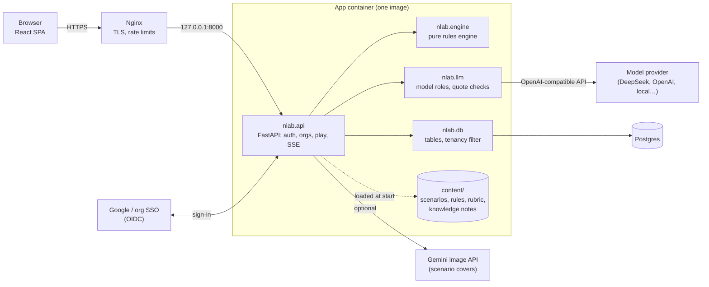

# Architecture

KROSS is one self-hostable web app: a React single-page app served by a FastAPI backend, with Postgres for storage
and any OpenAI-compatible model endpoint for language. The public instance is just one deployment of it.

## The core idea

**The model only describes. Code decides.**

- A model *labels* what the trainee said (which negotiation moves, which red lines, which proposals), and every label
  must carry a quote that code finds verbatim in the message, or it is dropped.
- A model *speaks* as the counterpart, from a prompt built by code.
- Plain Python rules move the hidden dials (trust, rigidity, hostility, consistency), reveal hidden interests, fire
  twists and decide outcomes. The rules are readable YAML; the engine is a pure, deterministic library.
- Every change is an event with its cause, so a trainer can see exactly why the counterpart softened or walked away.

## System overview



## Packages and their boundaries

The backend is one Python package, `nlab`, split into four layers. The boundaries are enforced by tests, not by
convention.

| Package | Responsibility | Boundary (enforced by) |
| --- | --- | --- |
| [`nlab.engine`](engine.md) | Rules engine: dials, moves, reveals, triggers, twists, outcomes, scenario validation | Pure: no files, environment, network, database or model calls (`tests/engine/test_boundary.py`) |
| [`nlab.llm`](llm.md) | Every model call: classifier, counterpart, grant check, evaluator, debrief, coach, converter… | No environment or file access; configuration and provider are passed in (`tests/llm/test_boundary.py`) |
| [`nlab.db`](backend.md#data-layer-nlabdb) | Tables, migrations and the functions that read and write them; tenant data filtered by `OrgContext` | No HTTP imports (`tests/api/test_layers.py`) |
| [`nlab.api`](backend.md) | FastAPI app: sign-in, sessions, CSRF, orgs, scenarios, play, limits, background scoring | Maps `nlab.db` errors to 404/403/409/410 |

The [frontend](frontend.md) is a React + TypeScript + Vite app whose API types are generated from the backend's
OpenAPI schema.

## Life of a turn

Hidden state never reaches the player during play; a trainer can watch it turn by turn.

```mermaid
sequenceDiagram
    autonumber
    participant P as Player
    participant A as nlab.api
    participant L as nlab.llm
    participant E as nlab.engine
    participant D as Postgres
    P->>A: POST /api/sessions/{id}/turns
    A->>D: claim the turn (conditional update)
    A->>L: classify the message
    L-->>A: moves + quotes (unverifiable quotes dropped)
    A->>E: step(state, classification)
    E-->>A: new state + events
    A->>L: counterpart request
    L-->>P: reply streamed (server-sent events)
    A->>L: grant check (if an outcome was offered earlier)
    A->>E: grant(...) re-checks the dials
    A->>D: save turn, events, state; release the claim
    A-)L: evaluator scores the turn (background)
```

1. The player starts a session on a scenario. The server pins the scenario version and the effective behaviour
   rules, so a debrief always matches what produced it.
2. The player sends a message. The server claims the turn with a conditional update on the session row; a second
   message while one is in flight gets `409`. No database transaction stays open during model calls.
3. The classifier labels the message. The quote check drops any label whose quote is not in the message.
4. The engine applies the turn: dials, reveals, triggers, scripted twists, then a `fail` ending or an outcome offered
   to the counterpart. No model call.
5. Unless the turn ended the session, the counterpart's reply streams to the browser as `text/event-stream` events
   (`reply`, `notice`, `error`, `done`).
6. If an outcome was offered on an earlier turn, the grant check asks whether this reply granted it; the engine
   re-checks the dials before accepting.
7. The turn, its classification, events and the engine state after it are saved, and the claim is released.
8. After the response, the evaluator scores the turn against the rubric in an in-process background task. A turn left
   unscored (for example by a restart) is scored at session end.
9. The session ends by an engine outcome or by the player. The debrief is written from the outcome and the turn
   scores; only then does the player see scores and metrics.

Every billed model call in this flow first passes [budget admission](backend.md#cost-control): it is checked against
the user, org, guest and deployment limits before it reaches the provider.

## Content

Curated content ships as files in [`content/`](../../content/) and is loaded once at start:

| File | What |
| --- | --- |
| [`scenarios/*.yaml`](../../content/scenarios/) | Curated scenarios; `python -m nlab.api.seed` loads them into the public library. Authoring guide: [`content/scenarios/README.md`](../../content/scenarios/README.md) |
| [`behaviour_rules.yaml`](../../content/behaviour_rules.yaml) | Dials, the move catalogue and how much each move changes each dial; every move names its source |
| [`rubric.yaml`](../../content/rubric.yaml) | Scoring clusters and dimensions (1–5 scale) and flags |
| [`knowledge/`](../../content/knowledge/) | CCHN tool notes and practice notes for the knowledge library and the debrief coach |
| [`scenario_bank.md`](../../content/scenario_bank.md) | The ICRC scenario bank the first scenarios came from; source documentation, not read at runtime |

Scenarios and rules created in the app live in Postgres. Every save creates a new immutable version; a play session
pins the versions it started with.

## Tenancy and roles

| Scope | Role | Can do |
| --- | --- | --- |
| Platform | superadmin | Manage curated public scenarios, create orgs, read the usage report |
| Org | admin | Invite and remove members, publish scenarios to the org library, edit the org's behaviour rules, watch and steer members' sessions |
| Org | member | Play org and public scenarios, create private scenarios, see their own sessions |

Every user gets a personal org. Every tenant-owned row carries `org_id`, and every query goes through the `nlab.db`
functions that take an `OrgContext` and filter by it.

## Where to read next

- [engine.md](engine.md): dials, moves, conditions and outcomes
- [llm.md](llm.md): model roles, quote checks and provider configuration
- [backend.md](backend.md): API, auth, data layer, limits and background work
- [frontend.md](frontend.md): screens, the trainer view and the editor
